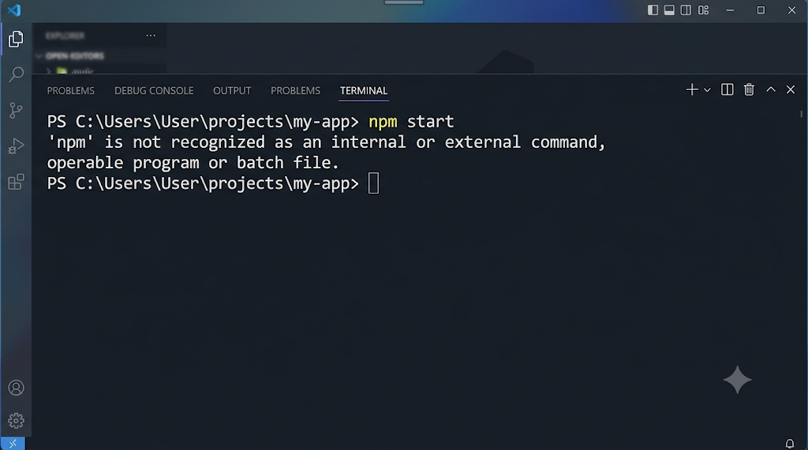

### Phần 1 – Googling đúng cách

1. Lý do lỗi: 
-Từ ngữ giao tiếp ("tại sao", "em", "vậy thầy") làm loãng từ khóa tìm kiếm kỹ thuật của Google.

2. Bóc tách:

Thành phần|	Nội dung bóc tách|
|---|---|
Tên phần mềm / Hệ điều hành|	Node.js, npm / Windows 11|
Mã lỗi nguyên văn|	`'npm' is not recognized as an internal or external command, operable program or batch file`.|
Thao tác đang làm	|Gõ lệnh `npm -v`|
3. Truy vấn:

- `site:stackoverflow.com npm not recognized command windows 11`
- `"npm' is not recognized as an internal or external command"`
- `npm not recognized command windows -xp`

### Phần 2:

1. So sánh

Tiêu chí|	Câu trả lời A	|Câu trả lời B|
|---|---|---|
Vote & Tích xanh	|+186, Có tích xanh (Accepted)|+2, Không có tích xanh
Thời gian đăng bài|	2 năm trước (Khá mới)|	9 năm trước (Quá cũ)|
Tags khớp HĐH/phần mềm|	`[node.js] [windows] [npm] `(Khớp hoàn toàn)	|`[node.js] [windows-xp]` (Sai hệ điều hành)

2. "Bẫy" của Câu B: 

-Driver mạng không liên quan đến biến PATH. Làm theo có thể làm hỏng kết nối Internet.

3. Đọc lướt 30s:
- 1. Kéo đến câu có tích xanh/vote cao ->
- 2. Xem lướt khung code -> 
- 3. Check comment xem có ai cảnh báo không.

Phần 3 – Hỏi AI & Nhận diện rủi ro

1. Prompt:

- [Ngữ cảnh]: Cài Node.js trên Win 11, đã thêm PATH và restart Terminal nhưng vẫn lỗi.
- [Lỗi nguyên văn]: Gõ `npm -v` báo `'npm' is not recognized...`
- [Yêu cầu]: Nêu 3 nguyên nhân phổ biến khác và cách kiểm tra từng bước.

2. Thẩm định an toàn: KHÔNG an toàn. Lệnh `del /f /s /q C:\Windows\System32\*` sẽ xóa sạch hệ điều hành, làm hỏng Windows vĩnh viễn.

3. Phản hồi AI: "Tại sao sửa biến PATH lại yêu cầu xóa file trong System32? Yêu cầu giải thích rõ các cờ /f /s /q." (Tuyệt đối không chạy thử).

Phần 4 – Bug Report

1. Tin nhắn kém: "Thầy ơi em gõ npm máy không nhận, em làm theo mạng rồi vẫn không được."

2. Bug Report Chuẩn:

Dưới đây là bản tóm gọn nhất:

Mảnh ghép|	Nội dung tin nhắn|
|---|---|
Context|	Em cài Node.js trên Win 11, đã thêm biến PATH và restart Terminal nhưng vẫn lỗi.
Expected	|Gõ npm -v ra số phiên bản.
Actual|	Báo lỗi nguyên văn:` 'npm' is not recognized...`
Log & Screenshot	|(Đính kèm ảnh chụp màn hình Terminal)

3. Phím tắt & Bảo mật:
Dùng `Win + Shift + S`. Lưu ý phải che (blur) các thông tin nhạy cảm như API Key, Password, Token đăng nhập vô tình lọt vào ảnh.
